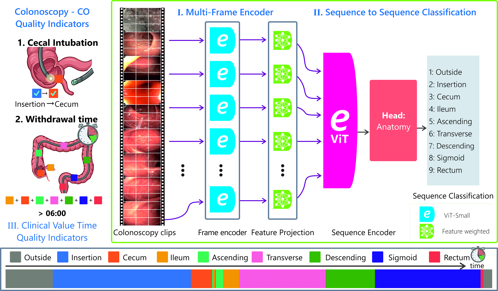
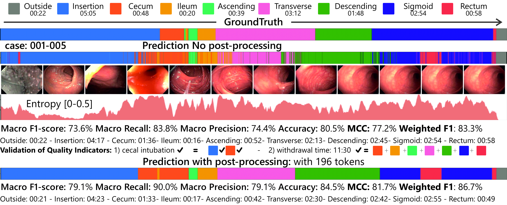

# Automated Colon-Audit: Temporal Modeling of Colonoscopy



Official code for **"Automated Colon-Audit: Temporal Modeling of Colonoscopy"** (SIPAIM 2026) — a Transformer-based framework for real-time colonoscopy procedural auditing.

## Abstract

Colonoscopy is the gold standard for colorectal cancer screening. The procedure quality determines adenoma detection rate and clinical outcomes. Key quality indicators, including cecal intubation and withdrawal time, require accurate assessment but they are not routinely quantified during clinical practice. Existing automated approaches rely on single-frame, short temporal windows or offline analysis to provide procedural auditing. Instead, this paper introduces Colon-Audit, a Transformer-based framework for real-time colonoscopy auditing. The proposed method leverages endoscopy-specific visual embeddings and a Vision Transformer to capture temporal dependencies, enabling sequence-level classification. We evaluate the proposed approach on 60 colonoscopy procedures comprising ∼2.7 million frames. Under the standard 5-fold evaluation protocol, Colon-Audit achieves a weighted F1-score of 74.1%, increasing to 76.2% after temporal post-processing. Under the more challenging cross-center 4-fold protocol, the proposed framework achieves a weighted F1-score of 68.9%, further improved to 71.2% with temporal post-processing. These results demonstrate the potential of long-range temporal modeling for real-time procedural auditing in routine colonoscopy.

## Anatomical Classification

**Table 1.** Comparison of the proposed Colon-Audit framework against baseline architectures on the REAL-Colon dataset. F1-score per anatomical class, plus weighted F1-score (wF1) and weighted Jaccard index (wJacc), evaluated on 60 complete colonoscopy procedures (∼2.7M frames).

*4-fold REAL-Colon — validate on different centers*

| Model | Outside | Insertion | Cecum | Ileum | Ascending | Transverse | Descending | Sigmoid | Rectum | wF1 | wJacc |
|---|---|---|---|---|---|---|---|---|---|---|---|
| Single-frame | 73.3 | 59.3 | 49.0 | 15.3 | 43.0 | 44.2 | 24.9 | 40.0 | 55.1 | 48.6 | 32.8 |
| Multi-frame | 79.5 | 85.1 | 65.4 | 51.2 | 53.1 | 68.9 | 32.9 | 58.5 | 69.7 | 68.9 | 54.5 |
| **Multi-frame+HMM** | **88.4** | **86.2** | **68.7** | **56.5** | **56.5** | **71.7** | **33.9** | **61.2** | **73.7** | **71.2** | **57.3** |
| Biffi (2025) [ColonTCN] | 87.9 | 84.9 | 49.2 | 30.1 | 41.6 | 56.7 | 26.2 | 53.0 | 65.7 | 62.7 | 48.6 |

*5-fold REAL-Colon — mix center*

| Model | Outside | Insertion | Cecum | Ileum | Ascending | Transverse | Descending | Sigmoid | Rectum | wF1 | wJacc |
|---|---|---|---|---|---|---|---|---|---|---|---|
| Single-frame | 87.2 | 64.1 | 49.3 | 22.3 | 45.7 | 50.1 | 27.8 | 44.1 | 57.0 | 52.9 | 36.9 |
| Multi-frame | 91.8 | 90.6 | 70.5 | 53.0 | 53.3 | 75.1 | 40.6 | 63.4 | 72.1 | 74.1 | 61.3 |
| **Multi-frame+HMM** | **94.8** | **91.7** | **74.3** | **68.3** | **55.7** | **77.2** | **42.7** | **65.9** | **75.2** | **76.2** | **63.9** |
| Biffi (2025) [ColonTCN] | 95.1 | 95.8 | 67.3 | 56.0 | 49.9 | 74.8 | 47.3 | 65.9 | 72.5 | 76.2 | 64.7 |

**Table 2.** Ablation study of Colon-Audit under different temporal context lengths and real-time inference performance.

*4-fold REAL-Colon — validate on different centers*

| Tokens | 16 | 50 | 75 | 135 | 196 | 392 | 588 | 784 |
|---|---|---|---|---|---|---|---|---|
| Seconds | 3.2 | 10 | 15 | 27 | 39.2 | 78.4 | 117.6 | 156.8 |
| Macro F1 | 58.9 | 63.9 | 64.3 | 63.5 | **64.6** | 61.7 | 62.7 | 62.5 |
| Weighted F1 | 59.0 | 64.9 | 66.4 | 67.0 | 68.1 | 67.4 | **68.9** | 68.5 |
| wF1+HMM | 61.0 | 66.4 | 68.2 | 68.3 | 69.6 | 69.0 | **71.2** | 70.9 |
| Latency (ms) | 156.8 | 165.1 | 159.4 | 162.0 | 157.4 | 172.9 | 172.8 | 170.7 |

*5-fold REAL-Colon — mix center*

| Tokens | 16 | 50 | 75 | 135 | 196 | 392 | 588 | 784 |
|---|---|---|---|---|---|---|---|---|
| Macro F1 | 63.8 | 68.2 | 69.1 | **69.9** | 68.6 | 69.0 | 67.8 | 68.0 |
| Weighted F1 | 65.0 | 69.4 | 70.6 | 72.5 | 72.5 | 73.7 | **74.1** | 73.8 |
| wF1+HMM | 67.6 | 70.5 | 72.0 | 73.6 | 73.7 | 74.7 | **76.2** | **76.2** |



## Pretrained Models

📥 **[Download the trained checkpoints](docs/models.md)** — both the "Single-frame" and "Multi-frame" (+HMM) models from Table 1, for the 5-fold and 4-fold protocols.

## Dataset

Experiments were conducted on the public **REAL-Colon** dataset: 60 fully annotated colonoscopy procedures (∼2.7 million frames) from six medical centers across three continents, following the official 5-fold and cross-center 4-fold evaluation protocols. See [docs/data.md](docs/data.md) for download and preparation instructions.

## Installation

```bash
git clone https://github.com/DiegoBravoH/Colon_Audit.git
cd Colon_Audit
pip install -r requirements.txt
```

See [docs/libraries.md](docs/libraries.md) for the full environment setup (Python/CUDA version, exact package versions).

## Code

**The training/testing code is embargoed until the paper is accepted.** The docs below describe what that code does and how it's used ahead of its release, so the pipeline is fully documented even while `classification/` itself isn't public yet.

The pipeline runs in three stages:

1. **[`features/`](features/)** — encodes every video frame through the frozen ViT-Small (GastroNet-5M) backbone into 384-dim embeddings. Published now. Documented in [docs/features.md](docs/features.md).
2. **`classification/single_frame/`** — the "Single-frame" baseline: a linear probe on the frozen embeddings, no temporal context. Documented in [docs/classification.md](docs/classification.md).
3. **`classification/multi_frame/`** — the "Multi-frame" / "Multi-frame+HMM" main method: the temporal ViT-Small model over sliding windows, with optional HMM smoothing. Documented in [docs/multi_frame.md](docs/multi_frame.md).

Both `classification/` pipelines consume the embeddings `features/` produces; `single_frame/` and `multi_frame/` are otherwise independent of each other.

## Notebooks

`colon_audit_demo.ipynb` runs the full inference pipeline (feature extraction → multi-frame classification → HMM smoothing) on a sample colonoscopy clip, downloading the pretrained weights automatically — no local setup needed.

[](https://colab.research.google.com/drive/1mHWefgWQia8MSYGo3VMCQS6n-Sd01bfh)

## Citation

The dataset this work builds on:

```bibtex
@article{biffi2024realcolon,
  title   = {REAL-Colon: A dataset for developing real-world AI applications in colonoscopy},
  author  = {Biffi, Carlo and Antonelli, Giulio and Bernhofer, Sebastian and Hassan, Cesare and Hirata, Daizen and Iwatate, Mineo and Maieron, Andreas and Salvagnini, Pietro and Cherubini, Andrea},
  journal = {Scientific Data},
  volume  = {11},
  number  = {1},
  pages   = {539},
  year    = {2024}
}
```
